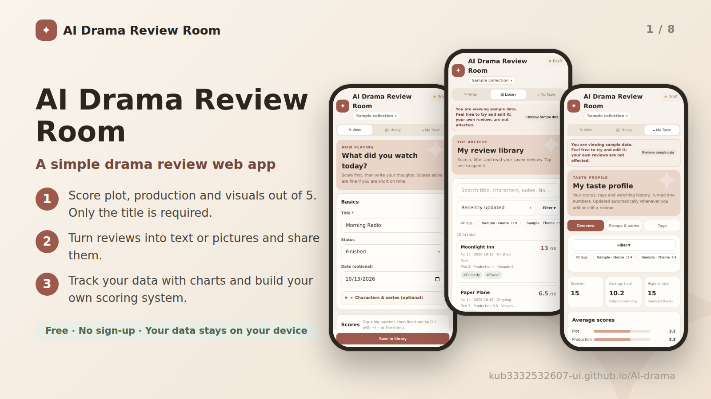
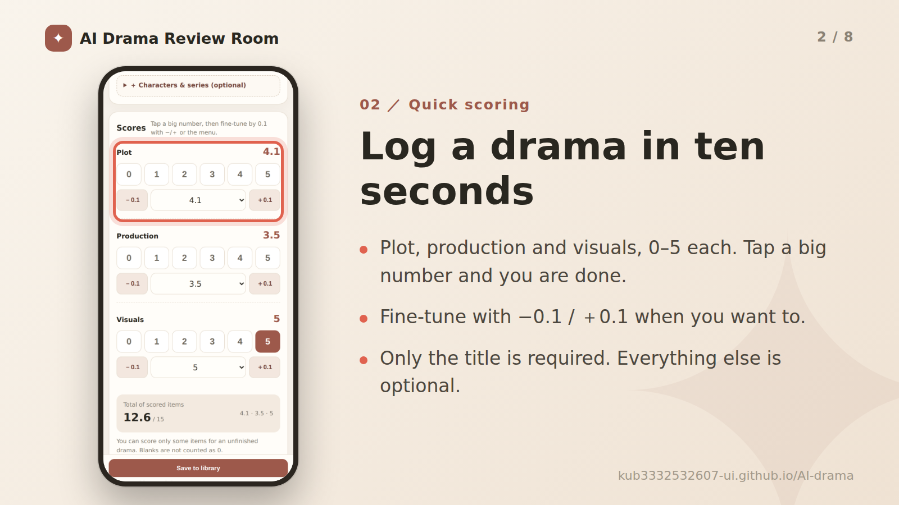
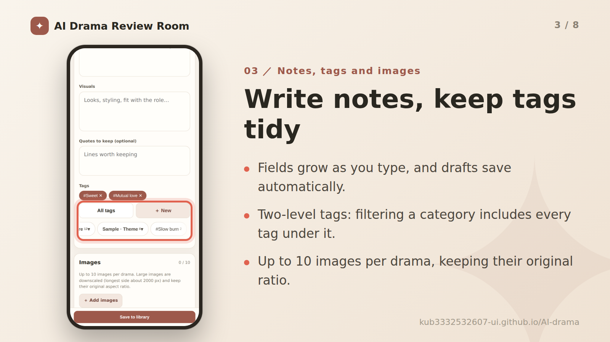
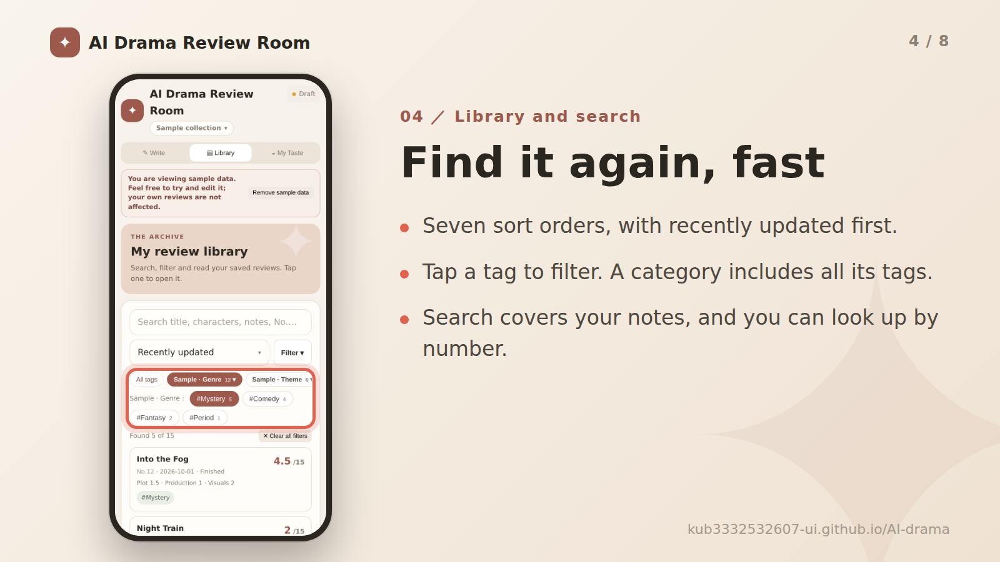
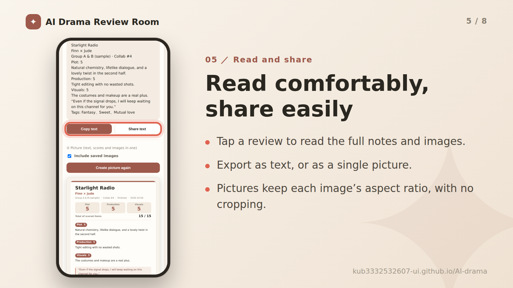
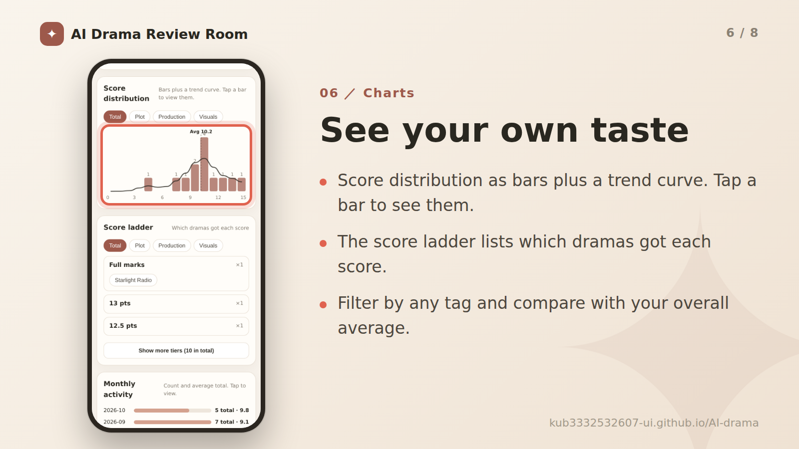
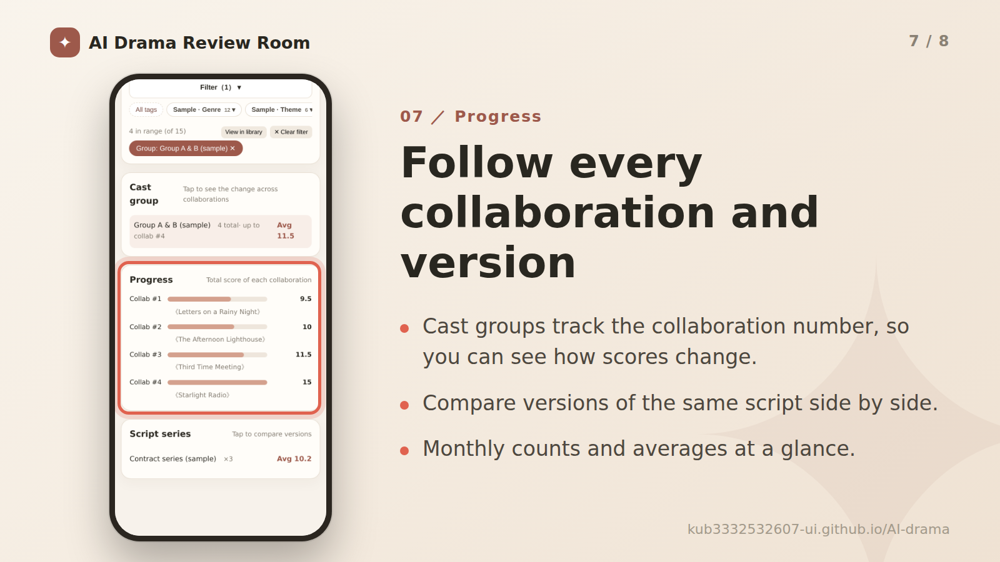
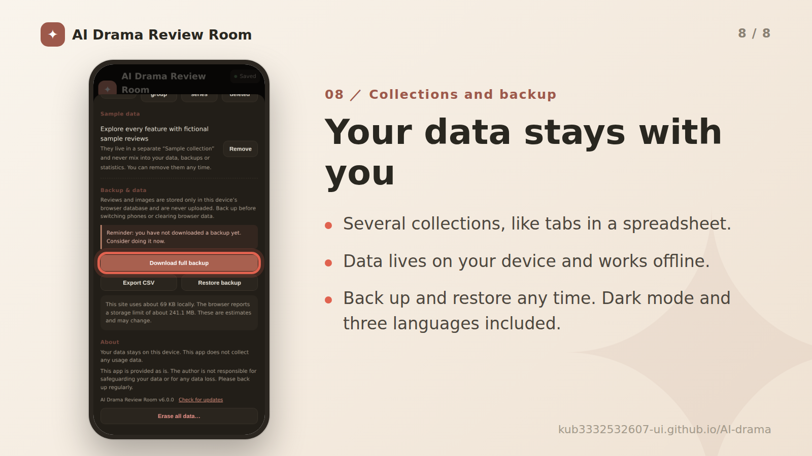

# AI 劇評室 (AI Drama Review Room)

**Use it now: [https://kub3332532607-ui.github.io/AI-drama/](https://kub3332532607-ui.github.io/AI-drama/)**

**Language: [繁體中文](README.md) | [简体中文](README.zh-CN.md) | English**

A simple drama review web app. Free, no sign-up, and your data stays on your device.

- **Three-part scoring out of 5**: plot, production and visuals. Only the title is required.
- **Share your thoughts**: turn a review into text or a picture and share it on social media.
- **Track your data**: charts and analysis that build your own scoring system.

**Supports**: dark mode, three languages (Traditional Chinese, Simplified Chinese, English), phones, tablets and desktops.

## Quick start

1. Open **Write**, enter a title, tap the big numbers to score, and add notes if you like.
2. Tap **Save to library**.
3. Later, search, filter, read, edit or export from **Library**.

> ▸ Want to look around first? Go to **Settings → Sample data → Load**. It creates a separate sample collection that you can remove with one tap, and it never mixes into your data, backups or statistics.
>
> ▸ Tap the ✦ icon at the top left to open **Settings**: switch language, manage collections and tags, back up and restore, and check the version.

## Features

## Install, data and privacy

Open the site in a browser and install it like an app. It then works offline.

- **Android (Chrome)**: menu → *Install app* or *Add to Home screen*.
- **iPhone / iPad (Safari)**: Share → *Add to Home Screen*.
- **Desktop (Chrome / Edge)**: the install icon at the right end of the address bar.

**Your data stays on your own device.** Reviews and images are stored in the browser’s database (IndexedDB). They are never uploaded, the author cannot see them, and the app does not collect any usage data.

Because the data lives only on this device, switching phones, clearing browser data or uninstalling the app can erase it. Download a backup regularly from **Settings → Backup & data**. To move to a new device, download a backup on the old one and use **Restore backup** on the new one.

This app is provided as is. The author is not responsible for safeguarding your data or for any data loss.

## FAQ

The screen did not change after an update.

Close the app completely (swipe it away from the app switcher) and open it twice. The version number is at the bottom of Settings, where you can also tap *Check for updates*.

A password, address or credit-card menu pops up when I type.

Single-line fields use a component that does not trigger autofill. If your browser still shows the menu, turn off autofill (passwords, payment methods, addresses) in its settings.

Does it work offline?

Yes. After the first visit and installation it works without a connection.

How do I change the language?

Use **Language** at the top of Settings. The first launch follows your phone’s language.

How do I erase everything?

Use **Erase all data** at the bottom of Settings. This cannot be undone, so back up first.

## License and changelog

Released under the [MIT License](LICENSE). The code was written and revised by the author together with Claude, Anthropic’s AI assistant. Feel free to adjust and update it as you need.

- **v6.5.0**: Data protection now offers "Back up to the cloud when the app opens" (toggle in Settings, on by default, no prompt); it only uploads when something changed since the last backup.
- **v6.4.0**: New "Data protection": if the database turns up empty at startup but the last record had data, writes are paused and a restore menu is offered (orphan images are no longer purged automatically); a local copy is kept outside the database after every save (OPFS, two rotating files); optional private Gist cloud backup (collapsed section in Settings, token stays on the device); and a startup/database log to help find the cause if something goes wrong.
- **v6.3.0**: New "Want to watch" status (excluded from taste-page stats and without the rewatch button); "Rewatched today" can now be tapped again to undo, and rewatch dates can be removed one by one.
- **v6.2.0**: Export picture redesigned in a magazine score style (big total score, thin color rule, score bars removed); the taste page now opens with a summary line and labels each chart's basis, and Monthly Watching becomes a three-tone stack by watch status; detail page gets “Rewatched today” and a score-change history; the tag quick menu now shows your 3 most recent tags, every category and an “Uncategorized” button; new collapsible “Also known as” aliases (searchable, shown in detail, optional in exports, checked for duplicates); the collection summary shows the next number.
- **v6.1.0**: New optional Links field when writing (up to 5, with quick-add name chips) and a per-collection switch for showing links in exports (off by default); choosing “None” for the cast pairing now clears the auto-filled round number; redesigned export picture.
- **v6.0.0**: Simplified Chinese and English added; sample data now includes low scores and English character names; new tag picker; the draft hint moved to the top right; sturdier backup, import and error handling.
- **v5.1.0**: Sample data (a separate collection you can load or remove any time).
- **v5.0.0**: Collections, two-level tags, script series, permanent numbers, seven sort orders, Settings, tabs and filters on My Taste, equal-height picture layout, dark mode.
