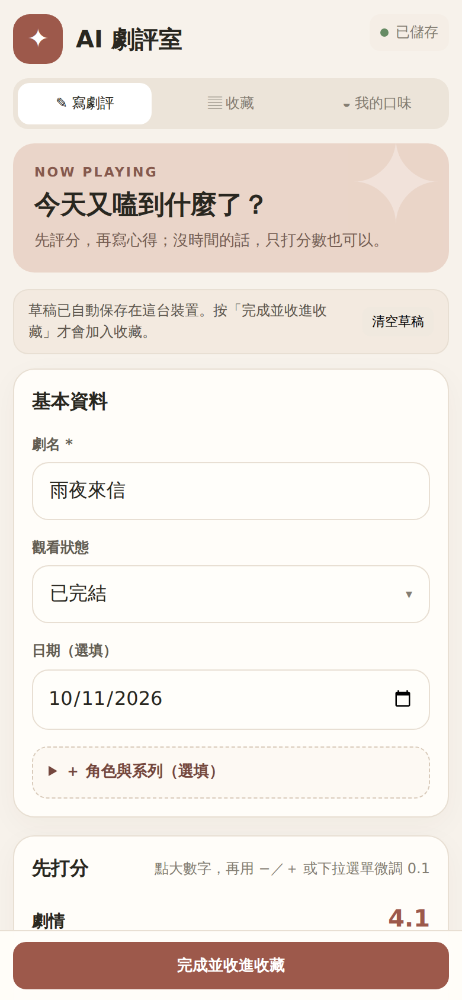
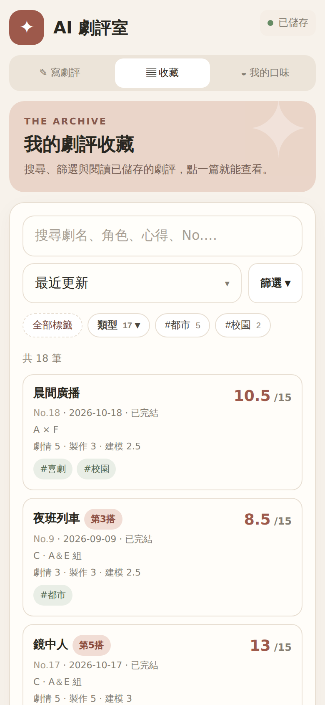
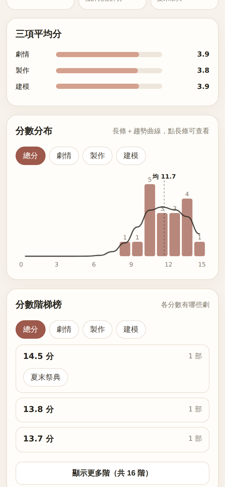

# AI 劇評室

**語言：繁體中文｜[English](README.en.md)**

一個可以離線使用的私人劇評日記。分項評分、寫心得、加標籤、收藏圖片，還能整理成圖片分享。
**所有資料只存在你自己的裝置裡，不會上傳到任何伺服器，也不需要註冊帳號。**

👉 **線上使用：** 請點本頁右側 **About** 區塊的網站連結（Website）。

| 寫劇評 | 收藏 | 我的口味 |
|:--:|:--:|:--:|
|  |  |  |

> 截圖中的劇名與內容皆為虛構的示範資料。

## 功能

- **分項評分**：劇情、製作、建模各 0–5 分，大按鈕選整數，再用 −0.1／＋0.1 或清單微調到 0.1。沒看完也能只評其中幾項。
- **心得與台詞**：欄位會隨文字自動變大；草稿自動保存，不怕寫到一半被中斷。
- **標籤**：支援「大標籤／小標籤」。劇評只記小標籤，篩選大標籤時會一併包含底下所有小標籤。打新標籤時會提醒有沒有相近的，避免重複。
- **收藏庫**：像試算表的分頁，每個收藏庫各自有編號、演員組合、劇本系列與輸出標籤。只有一個收藏庫時完全不會多出任何東西。
- **角色、演員組合、第幾搭、劇本系列**：都是選填。可以只記一位角色，或以「A × B」記兩位；同一組演員追到第幾搭、同一套劇本的不同版本，都能整理起來互相比較。
- **收藏與搜尋**：七種排序、標籤篩選、搜尋心得內容、依編號查找；點一篇就能直接閱讀。
- **我的口味**：平均分、分數分布（長條＋曲線）、分數階梯榜、每月追劇、組合與系列的進度、標籤對比。資料不夠時會顯示解鎖進度，而不是空白。
- **輸出**：複製或分享文字；也能產生一張圖（含分數、心得、標籤與收藏圖片，依原本比例排版）。
- **備份**：下載或分享完整備份（含圖片）；刪除的劇評保留 30 天可救回；還原時可選「合併」或「取代」。
- 支援深色模式，手機與電腦版面都有針對調整。

## 安裝到手機或電腦

用瀏覽器打開網站後，可以安裝成像 App 一樣的圖示，之後沒有網路也能使用。

- **Android（Chrome）**：右上角選單 → 「安裝應用程式」或「加到主畫面」。
- **iPhone／iPad（Safari）**：下方「分享」按鈕 → 「加入主畫面」。
- **電腦（Chrome／Edge）**：網址列右側的「安裝」圖示。

## 快速上手

1. 到「寫劇評」輸入劇名，點大數字打分，需要的話再寫心得。
2. 按「完成並收進收藏」。之後在「收藏」裡搜尋、篩選、閱讀、編輯或輸出。
3. 點左上角的 ⚙ 打開**設定**：管理收藏庫、標籤、組合、系列，備份與還原，查看版本。

## 資料與隱私

- 劇評與圖片保存在這台裝置的瀏覽器資料庫（IndexedDB），**不會傳到網路上**，作者也看不到你的內容。
- 因為資料只在本機，**換手機、清除瀏覽器資料、解除安裝 App** 都可能讓資料消失。請定期到「設定 → 備份與資料」下載備份；備份檔可存到雲端硬碟。
- 換裝置時：在舊裝置下載備份 → 在新裝置打開網站 → 「設定 → 還原備份」。

## 常見問題

**更新後畫面沒有變？**
把 App 完全關掉（從多工畫面滑掉）再開兩次。到「設定」最下方可以看到版本號，也能按「檢查更新」。

**打字時跳出密碼、地址或信用卡選單？**
App 的單行輸入框已經改用不會觸發自動填入的元件。如果你的瀏覽器仍然跳出，可以到 Chrome 的設定關閉自動填入（密碼、付款方式、地址）。

**沒有網路可以用嗎？**
可以。第一次打開並安裝後，之後離線也能使用。

**如何完全清除資料？**
設定 → 最下方「清除全部資料」。這個動作無法復原，請先備份。

## 自己架設

這是純靜態網頁（單一 `index.html`，沒有任何建置步驟或外部套件）。

1. 在本頁右上角按 **Fork**。
2. 進入你的 repo → **Settings → Pages** → Source 選 **Deploy from a branch**，Branch 選 `main`、資料夾選 `/ (root)` → Save。
3. 約一分鐘後，頁面上方會出現你的網站網址。

## 授權

以 [MIT License](LICENSE) 釋出，歡迎自由使用與修改。

## 更新紀錄

- **v5.0.0**：收藏庫（多個分頁）、大小標籤、劇本系列、永久編號、七種排序、設定頁、口味頁分頁與篩選、分數分布曲線與階梯榜、圖片等高排版、分享文字與備份、桌面版版面、深色模式。
- **v4.0.0**：大小標籤、劇本系列、編號、草稿與編輯分離。
- **v3.0.0**：角色與演員組合、標籤篩選、最近刪除、備份還原選項。
