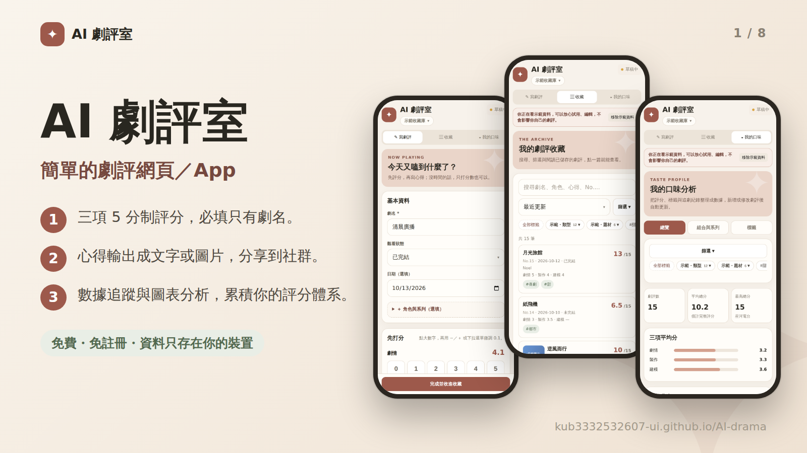
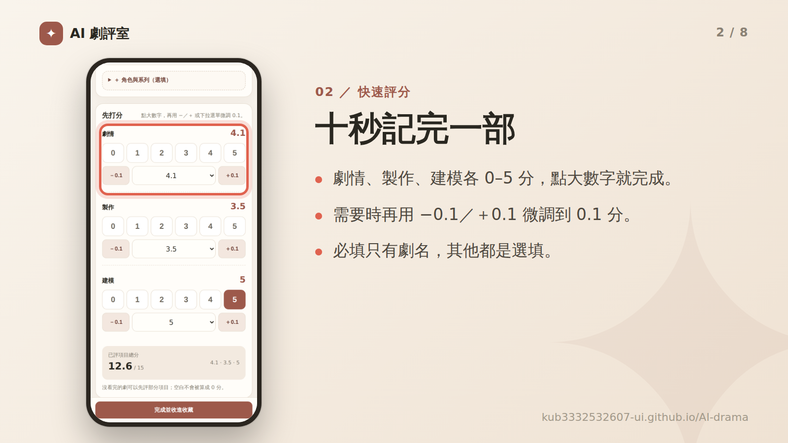
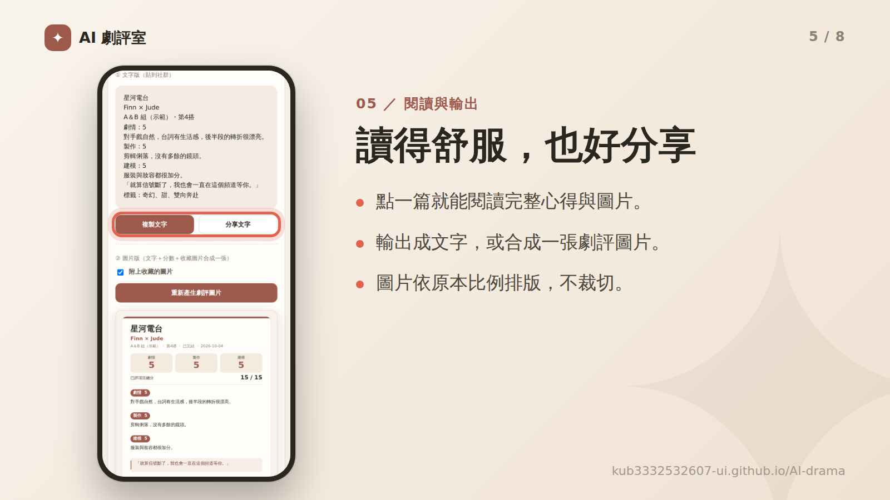
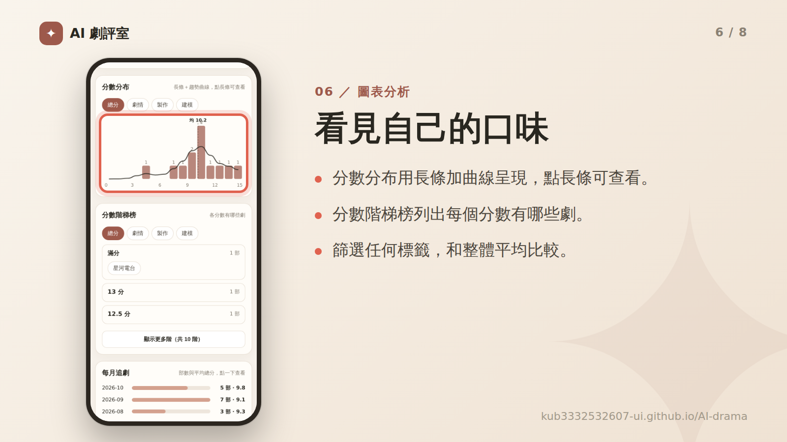
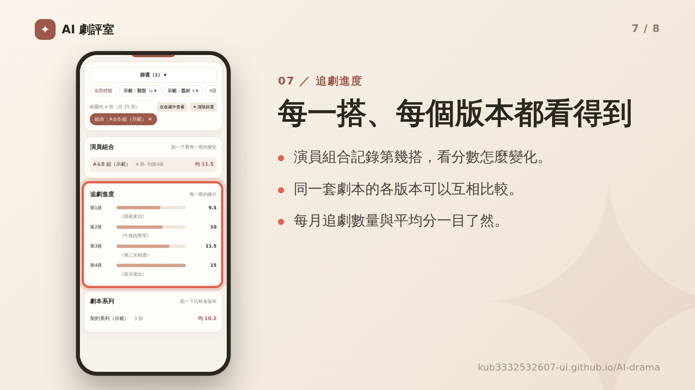
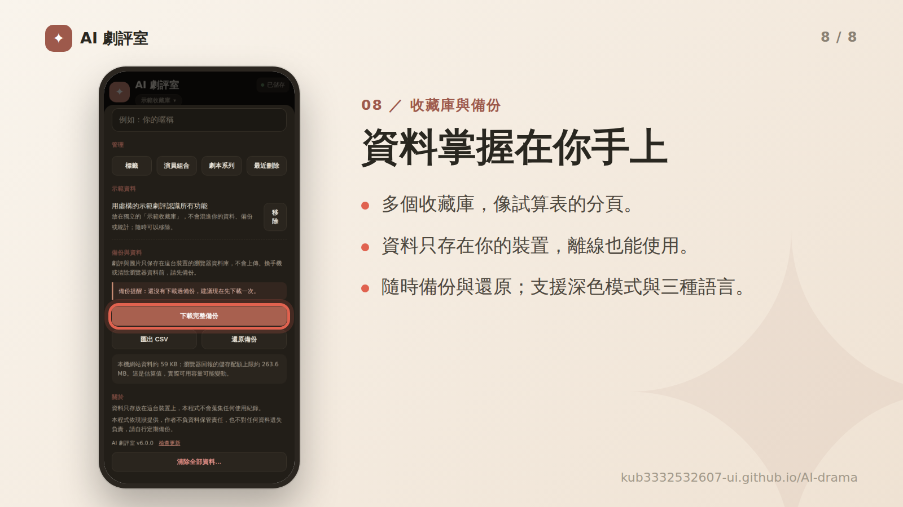

# AI 劇評室

**立即使用：[https://kub3332532607-ui.github.io/AI-drama/](https://kub3332532607-ui.github.io/AI-drama/)**

**語言：繁體中文｜[簡體中文](README.zh-CN.md)｜[English](README.en.md)**

簡單的劇評網頁／App。免費、免註冊，資料只存在你的裝置。

- **三項 5 分制評分**：劇情、製作、建模，必填只有劇名。
- **心得輸出**：整理成文字或圖片，分享到社群。
- **數據追蹤**：圖表分析，累積你的評分體系。

**支援**：深色模式、三種語言（繁體中文、簡體中文、English）、手機、平板與電腦。

## 快速上手

1. 到「寫劇評」輸入劇名，點大數字打分，需要的話再寫心得。
2. 按「完成並收進收藏」。
3. 之後在「收藏」搜尋、篩選、閱讀、編輯或輸出。

> ▸ 想先看看所有功能？到「設定 → 示範資料」按「載入」，會建立一個獨立的示範收藏庫，隨時可以一鍵移除，不會混進你的資料、備份或統計。
>
> ▸ 點左上角的圖示 ✦ 打開**設定**：切換語言、管理收藏庫與標籤、備份與還原、查看版本。

## 功能

## 安裝與資料隱私

用瀏覽器打開網站後，可以安裝成像 App 一樣的圖示，之後沒有網路也能使用。

- **Android（Chrome）**：右上角選單 → 「安裝應用程式」或「加到主畫面」。
- **iPhone／iPad（Safari）**：下方「分享」按鈕 → 「加入主畫面」。
- **電腦（Chrome／Edge）**：網址列右側的「安裝」圖示。

**資料只存在你自己的裝置上。** 劇評與圖片保存在瀏覽器資料庫（IndexedDB），不會上傳到網路，作者也看不到，程式不會蒐集任何使用紀錄。

因為資料只在本機，換手機、清除瀏覽器資料或解除安裝 App，都可能讓資料消失。請定期到「設定 → 備份與資料」下載備份；換裝置時，在舊裝置下載備份，再到新裝置的「設定 → 還原備份」。

本程式依現狀提供，作者不負資料保管責任，也不對任何資料遺失負責。

## 常見問題

更新後畫面沒有變？

把 App 完全關掉（從多工畫面滑掉）再開兩次。到「設定」最下方可以看到版本號，也能按「檢查更新」。

打字時跳出密碼、地址或信用卡選單？

單行輸入框已改用不會觸發自動填入的元件。如果仍然跳出，可以到瀏覽器設定關閉自動填入（密碼、付款方式、地址）。

沒有網路可以用嗎？

可以。第一次打開並安裝後，離線也能使用。

怎麼換語言？

「設定」最上方的「語言」。第一次打開會依手機語言自動選擇。

如何完全清除資料？

設定最下方的「清除全部資料」。這個動作無法復原，請先備份。

## 授權與更新紀錄

本專案以 [MIT License](LICENSE) 釋出。程式碼由作者與 Claude（Anthropic 的 AI 助手）協作撰寫與修改，歡迎依需求自行調整與更新。

- **v6.5.0**：資料保護新增「開啟 App 時自動雲端備份」（設定頁可開關，預設開，不跳提示）；只在上次備份後有變動時才上傳。
- **v6.4.0**：新增「資料保護」：啟動時若資料庫變空但上次記錄有資料，會暫停寫入並提供還原選單（不再自動清掉圖片）；每次儲存後自動在資料庫之外留一份本機副本（OPFS，雙檔輪替）；可選用私人 Gist 雲端備份（設定頁的收起區塊，權杖只存在本機）；並記錄啟動與資料庫狀態的紀錄，方便日後查原因。
- **v6.3.0**：觀看狀態新增「想看」（不進口味頁統計，也不顯示「今天回看了」）；「今天回看了」可再按一次取消，回看日期可逐筆移除。
- **v6.2.0**：輸出圖片改為雜誌評分風（大字總分、左側色線，拿掉分數長條）；口味頁最上方新增摘要並標註各圖的統計基準，每月追劇改為依觀看狀態分深淺的三層堆疊；詳情頁新增「今天回看了」與分數修改歷史；寫劇評的標籤快速選單改為最近用過 3 個、全部大標籤與「未分類」；新增可收起的「又名」（支援搜尋、詳情、輸出與重複劇名檢查）；收藏頁摘要顯示下一部的編號。
- **v6.1.0**：寫劇評新增「連結」欄位（最多 5 個，可快速加入常用名稱），收藏庫可設定輸出時是否顯示連結（預設關閉）；改選「不指定」演員組合時會一併清除自動帶入的第幾搭；全新設計的輸出圖片。
- **v6.0.0**：新增簡體中文與 English；示範資料加入低分與英文人名；新的標籤選擇方式；草稿提示移到右上角；備份、匯入與錯誤處理更穩固。
- **v5.1.0**：示範資料（獨立的示範收藏庫，可隨時載入或移除）。
- **v5.0.0**：收藏庫、大小標籤、劇本系列、永久編號、七種排序、設定頁、口味頁分頁與篩選、圖片等高排版、深色模式。
