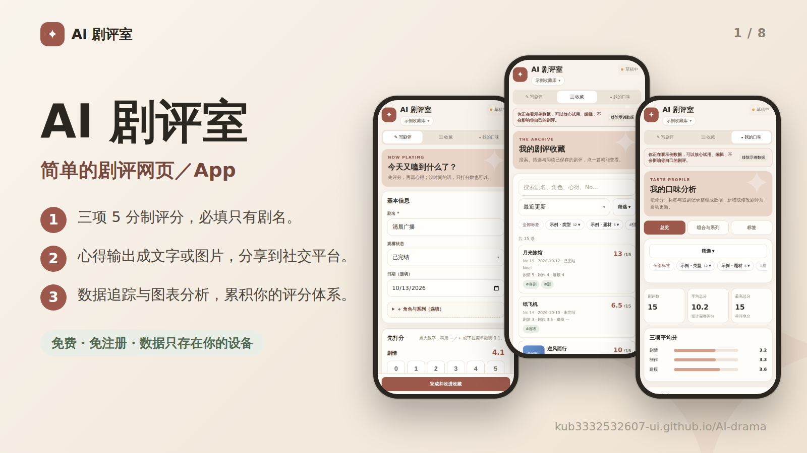
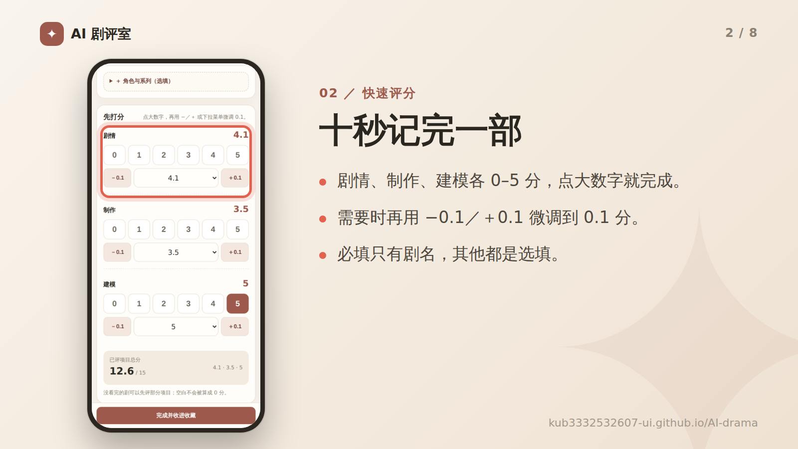
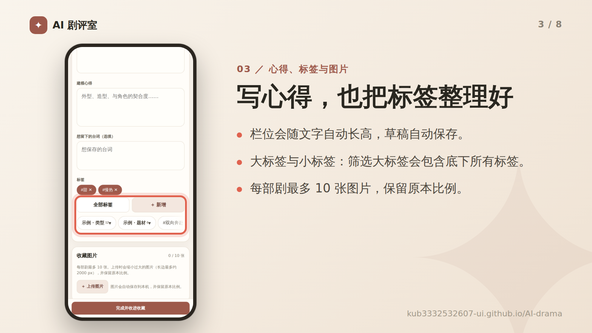
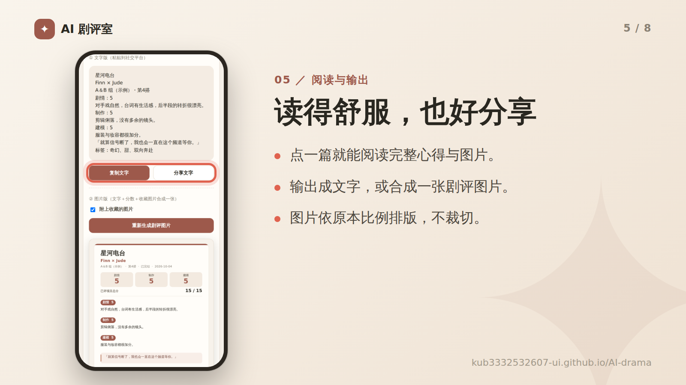
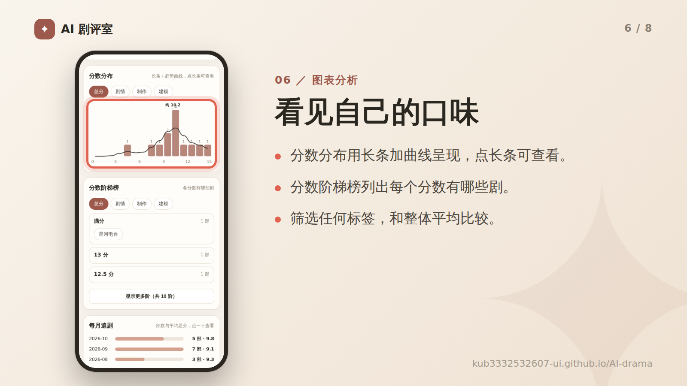
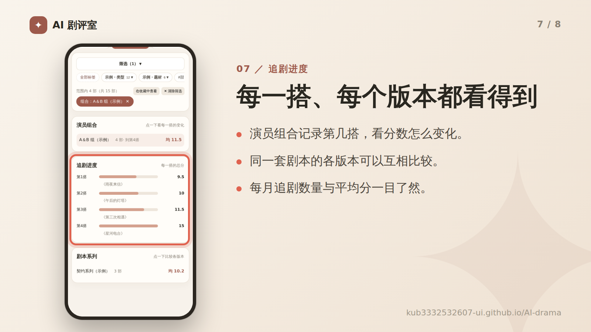
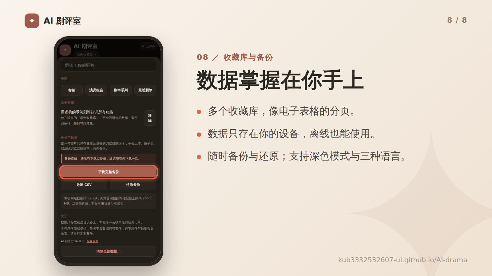

# AI 剧评室

**立即使用：[https://kub3332532607-ui.github.io/AI-drama/](https://kub3332532607-ui.github.io/AI-drama/)**

**语言：[繁體中文](README.md)｜简体中文｜[English](README.en.md)**

简单的剧评网页／App。免费、免注册，数据只存在你的设备。

- **三项 5 分制评分**：剧情、制作、建模，必填只有剧名。
- **心得输出**：整理成文字或图片，分享到社交平台。
- **数据追踪**：图表分析，累积你的评分体系。

**支持**：深色模式、三种语言（繁体中文、简体中文、English）、手机、平板与电脑。

## 快速上手

1. 到「写剧评」输入剧名，点大数字打分，需要的话再写心得。
2. 按「完成并收进收藏」。
3. 之后在「收藏」搜索、筛选、阅读、编辑或输出。

> ▸ 想先看看所有功能？到「设置 → 示例数据」按「加载」，会建立一个独立的示例收藏库，随时可以一键移除，不会混进你的数据、备份或统计。
>
> ▸ 点左上角的图标 ✦ 打开**设置**：切换语言、管理收藏库与标签、备份与还原、查看版本。

## 功能

## 安装与数据隐私

用浏览器打开网站后，可以安装成像 App 一样的图标，之后没有网路也能使用。

- **Android（Chrome）**：右上角菜单 → 「安装应用程序」或「加到主画面」。
- **iPhone／iPad（Safari）**：下方「分享」按钮 → 「加入主画面」。
- **电脑（Chrome／Edge）**：网址列右侧的「安装」图标。

**数据只存在你自己的设备上。** 剧评与图片保存在浏览器数据库（IndexedDB），不会上传到网路，作者也看不到，程序不会收集任何使用记录。

因为数据只在本机，换手机、清除浏览器数据或卸载 App，都可能让数据消失。请定期到「设置 → 备份与数据」下载备份；换设备时，在旧设备下载备份，再到新设备的「设置 → 还原备份」。

本程序依现状提供，作者不负数据保管责任，也不对任何数据丢失负责。

## 常见问题

更新后画面没有变？

把 App 完全关掉（从多任务界面滑掉）再开两次。到「设置」最下方可以看到版本号，也能按「检查更新」。

打字时跳出密码、地址或信用卡菜单？

单行输入框已改用不会触发自动填入的元件。如果仍然跳出，可以到浏览器设置关闭自动填入（密码、付款方式、地址）。

没有网路可以用吗？

可以。第一次打开并安装后，离线也能使用。

怎么换语言？

「设置」最上方的「语言」。第一次打开会依手机语言自动选择。

如何完全清除数据？

设置最下方的「清除全部数据」。这个动作无法复原，请先备份。

## 授权与更新记录

本专案以 [MIT License](LICENSE) 释出。程序码由作者与 Claude（Anthropic 的 AI 助手）协作撰写与修改，欢迎依需求自行调整与更新。

- **v6.6.0**：云端备份改为真正的双向同步：打开或回到 App、数据变动后，会先下载其他设备的变更再合并上传（新增、修改、删除都会同步，同一篇两边都改时以较新的为准）；两台同时新增造成编号重复时，较早建立的保留原号，较晚的改用下一个编号并提示。
- **v6.5.0**：数据保护新增“打开 App 时自动云端备份”（设置页可开关，默认开，不弹提示）；只在上次备份后有变动时才上传。
- **v6.4.0**：新增“数据保护”：启动时若数据库变空但上次记录有数据，会暂停写入并提供还原选单（不再自动清掉图片）；每次保存后自动在数据库之外留一份本机副本（OPFS，双文件轮替）；可选用私人 Gist 云端备份（设置页的收起区块，令牌只存在本机）；并记录启动与数据库状态的记录，方便日后查原因。
- **v6.3.0**：观看状态新增“想看”（不进口味页统计，也不显示“今天回看了”）；“今天回看了”可再按一次取消，回看日期可逐笔移除。
- **v6.2.0**：输出图片改为杂志评分风（大字总分、左侧色线，去掉分数长条）；口味页最上方新增摘要并标注各图的统计基准，每月追剧改为依观看状态分深浅的三层堆叠；详情页新增“今天回看了”与分数修改历史；写剧评的标签快速选单改为最近用过 3 个、全部大标签与“未分类”；新增可收起的“又名”（支持搜索、详情、输出与重复剧名检查）；收藏页摘要显示下一部的编号。
- **v6.1.0**：写剧评新增“链接”栏位（最多 5 个，可快速加入常用名称），收藏库可设置输出时是否显示链接（默认关闭）；改选“不指定”演员组合时会一并清除自动带入的第几搭；全新设计的输出图片。
- **v6.0.0**：新增简体中文与 English；示例数据加入低分与英文人名；新的标签选择方式；草稿提示移到右上角；备份、汇入与错误处理更稳固。
- **v5.1.0**：示例数据（独立的示例收藏库，可随时加载或移除）。
- **v5.0.0**：收藏库、大小标签、剧本系列、永久编号、七种排序、设置页、口味页分页与筛选、图片等高排版、深色模式。
